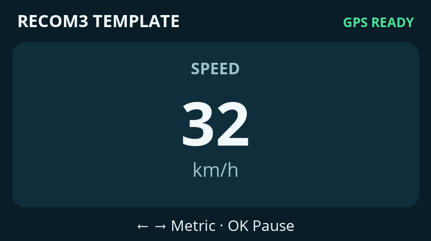

# Recom3Template

Start a Java app for the **Recon Snow2** HUD. The template opens a landscape, full-screen GPS dashboard. The remote switches between speed and horizontal accuracy and can pause GPS updates. The project is based on [Recom3Ghost](https://github.com/recom3/Recom3Ghost).

[SDK guide](docs/sdk.md) · [HUD and remote guide](docs/ui.md) · [Build and sign a release APK](docs/publishing.md)

## HUD preview



*Mockup of the 428 × 240 HUD with sample GPS data.*

## Build your first APK

1. On GitHub, select **Use this template → Create a new repository**, then clone your copy.
2. Install **JDK 8**, **Android SDK Platform 27**, **Build Tools 27.0.3** and **Android SDK Platform-Tools** from SDK Manager. The wrapper uses Gradle 4.1 with Android Gradle Plugin 3.0.1.
3. Set `JAVA_HOME` to your JDK 8 folder and `ANDROID_HOME` to your Android SDK folder. Example for PowerShell. Replace the paths with yours.

   ```powershell
   $env:JAVA_HOME = 'C:\Java\jdk8'
   $env:ANDROID_HOME = "$env:LOCALAPPDATA\Android\Sdk"
   .\gradlew.bat :app:assembleDebug
   ```

   On macOS or Linux, export the same variables and run `sh ./gradlew :app:assembleDebug`. Gradle can also read the SDK path from a local `local.properties` file, such as `sdk.dir=C:/Android/Sdk`. The first Gradle build downloads Gradle and its dependencies.

4. With the Snow2 connected over USB and visible in `adb devices`, install and launch the example. [Android Debug Bridge documentation](https://developer.android.com/tools/adb)

   ```powershell
   $adb = Join-Path $env:ANDROID_HOME 'platform-tools/adb.exe'
   & $adb devices
   & $adb install -r app/build/outputs/apk/debug/app-debug.apk
   & $adb shell am start -n com.recom3.template/.TemplateActivity
   ```

   Wait outdoors for **GPS READY**. Press **Left** or **Right** to change the metric, **OK** to pause or resume, and **Back** to leave.

## Make it your own

| Change | Where |
| --- | --- |
| Give your app a unique install ID and set its version | [app/build.gradle](app/build.gradle) |
| Set the Java namespace | Refactor `com.recom3.template` in [Java sources](app/src/main/java/com/recom3/template/) and update the manifest's `package` and any component names affected |
| Set the project and display names | [settings.gradle](settings.gradle) and [strings.xml](app/src/main/res/values/strings.xml) |
| Change the launcher icon and full-screen theme | [AndroidManifest.xml](app/src/main/AndroidManifest.xml), [drawable resources](app/src/main/res/drawable/) and [styles.xml](app/src/main/res/values/styles.xml) |
| Add a data source or a remote action | [TemplateActivity.java](app/src/main/java/com/recom3/template/TemplateActivity.java) |
| Change the layout or add a metric | [TemplateHud.java](app/src/main/java/com/recom3/template/TemplateHud.java) and [the HUD guide](docs/ui.md) |

Start by changing the display name and the speed unit. A second small exercise is to add an altitude metric using `Location.hasAltitude()` and `Location.getAltitude()` in the activity. The HUD already draws a label, a value and a unit.

The build compiles against API 27 and keeps both `minSdkVersion` and `targetSdkVersion` at 16 for Snow2. Standard Android APIs provide the GPS, rendering and key input. The [Recon SDK guide](docs/sdk.md) explains how to add device services such as heading or phone connectivity.

## Licenses

- Template and Recom3Ghost-derived application code under the [MIT License](LICENSE).
- Recon Instruments font loader under the [Artistic License 2.0](reconUI/LICENSE). See [reconUI credits](reconUI/README.md).
- Open Sans fonts under the [Apache License 2.0](reconUI/LICENSE-OpenSans.txt).
